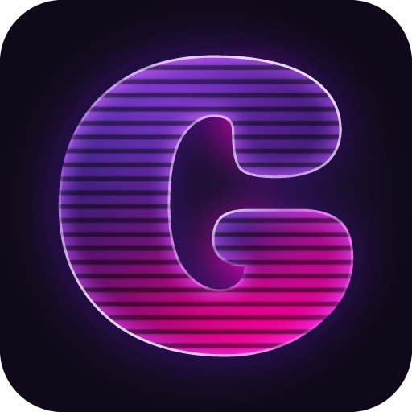
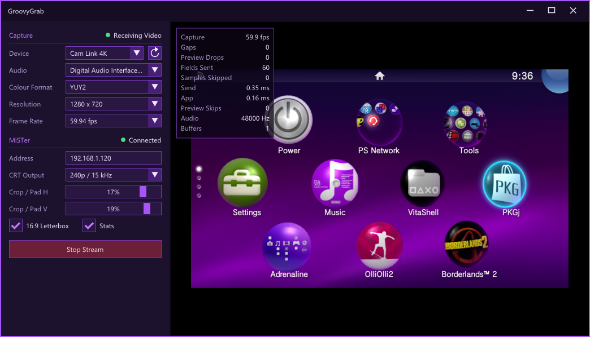
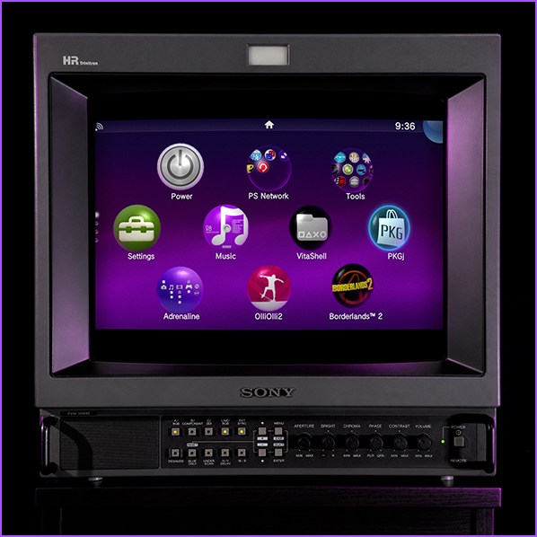

# GroovyGrab



Stream an HDMI capture card to a CRT through a MiSTer, with about 5 to 6 ms from capture to scanout (measured on a Cam Link 4K).

<p>
  
  
</p>

**Experimental.** Provided as is, with no guarantees, so use it at your own risk. It sends custom video timings to your CRT and runs a modified core on your MiSTer. It's made for the included GroovyGrab core. In theory it also works on stock Groovy, but there are no guarantees.

## Why

Many newer consoles and handhelds only have HDMI out. GroovyGrab uses an HDMI capture card as a bridge, so you can play them on a CRT through your MiSTer.

Every capture card adds some delay of its own, and no software can remove it. GroovyGrab's goal is to add as little as possible on top: everything after the capture card takes only a few milliseconds.

That makes it a good fit for slower-paced games and anything that doesn't need frame-perfect input. It works with any HDMI device your capture card accepts. Most cards refuse copy-protected (HDCP) video, which some consoles let you turn off in their settings.

## What you need

- Windows 10 or later, x64
- A UVC HDMI capture card
- A MiSTer on a wired gigabit network
- A 15 kHz CRT

## Setup

Download the zip from the latest release.

1. Copy the contents of its `SD card` folder to the root of the MiSTer's SD card.
2. Add this to the end of `MiSTer.ini` on the SD card:

```
[GroovyGrab]
main=MiSTer_GroovyGrab
```

3. Start GroovyGrab from the MiSTer's Utility menu.
4. Run `GroovyGrab.exe` from the zip's `PC` folder, pick your capture device and mode, enter the MiSTer's address and press **Start Stream**.

The picture appears after a few seconds of black. On stock Groovy you get 10 seconds of a Calibrating image first.

## Settings

Settings are saved to `GroovyGrab.ini` next to the app.

| Setting | Default | What it does |
|---|---|---|
| **Device** | First capture card found | Capture card |
| **Audio** | The capture card's audio | Audio sent with the stream |
| **Colour Format** | Device default | Capture format |
| **Resolution** | Device default | Capture size. Pick what your source outputs, so the card doesn't scale |
| **Frame Rate** | Device default | Capture rate. Rates near 50 fps switch to PAL modes |
| **Address** | Empty | MiSTer IP address |
| **CRT Output** | 480i | 480i or 240p (576i or 288p for PAL rates) |
| **16:9 Letterbox** | Off | Fits 16:9 content inside the 4:3 picture |
| **Stats** | Off | Shows live statistics over the preview |
| **Crop / Pad H**, **Crop / Pad V** | 0 % | Positive values crop, negative values add black bars |

**F11** toggles a fullscreen preview, and **Esc** leaves it.

Command line options: a device name, `--240p`, `--480i`, `--send` (start streaming), `--letterbox`, `--console` (show the log), `--stats` (print timings), `--no-lock` (don't lock to the capture card's clock).

## How it works

A capture card and a MiSTer run on separate clocks. Normally that means each frame waits for up to a full field, and a frame gets dropped whenever the clocks drift apart. GroovyGrab matches the MiSTer's pixel clock to the capture card instead, so each frame goes out as soon as it arrives and lands just ahead of scanout.

The GroovyGrab core makes tiny adjustments to its pixel rate during blanking, so you don't see any correction. Stock Groovy can only change its clock with a small reset, which can nudge the picture, so the app does that as rarely as it can.

Rates that are a clean multiple of the mode's, like 30 fps, lock too. Anything else runs at the standard clock.

## What's in this repository

| Folder | What it is | License |
|---|---|---|
| `src`, `tests`, `assets` | The Windows app | GPL-3.0 or later, see [LICENSE](LICENSE) |
| [`core`](core) | The GroovyGrab core, a fork of Groovy | Mixed, built cores are GPL-3.0, see [its LICENSE](core/LICENSE) |
| [`server`](server) | `MiSTer_GroovyGrab`, the MiSTer binary the core runs with | GPL-3.0, see [its LICENSE](server/LICENSE) |

## Building the app

```
build.bat
```

This needs the Visual Studio Build Tools with the x64 C++ tools, and writes `build\GroovyGrab.exe` and `turbojpeg.dll`.

To build with CMake instead, which also builds a conversion test:

```
cmake -B build-cmake
cmake --build build-cmake --config Release
```

The core and server have their own build steps in their folders.

## License

The app is licensed under the GNU General Public License, version 3 or any later version. The core and server folders keep their own licenses, as above.

## Third-party components

These keep their own licenses, in `third_party`:

- [Dear ImGui](https://github.com/ocornut/imgui), including its ProggyClean font: MIT
- [LZ4](https://github.com/lz4/lz4): BSD 2-Clause
- [libjpeg-turbo](https://libjpeg-turbo.org): IJG, Modified BSD and zlib

This software is based in part on the work of the Independent JPEG Group.

The app uses Segoe UI and other fonts already installed with Windows, and doesn't include them.

## AI disclosure

This project was developed with substantial help from Claude Code.
